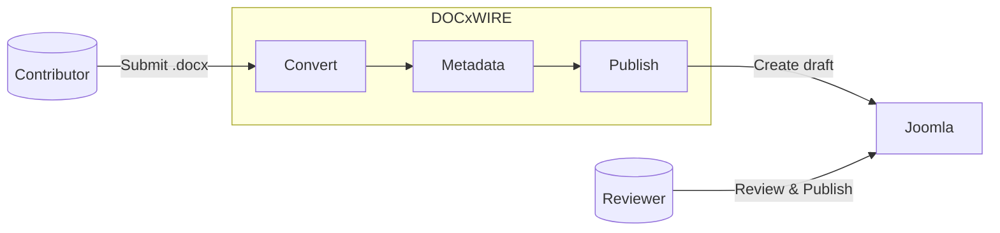

# DOCxWIRE

[](https://conventionalcommits.org)

> Built for the [Heilbronner Rudergesellschaft Schwaben](https://www.ruderschwaben.de/) — but designed
> for reuse. See [`MOTIVATION.md`](MOTIVATION.md).

Converts `.docx` files to clean HTML and publishes them as draft articles to a Joomla 5 website.



## Getting started

This project uses [uv](https://docs.astral.sh/uv/) for dependency management.

To set up your environment, run:

```bash
make setup   # Setup environment
```

[Make](https://www.gnu.org/software/make/) serves as the task runner for code quality and testing. Available targets:

```bash
make test     # Run test suite with coverage
make check    # Run all checks
make ci       # Full CI (lint + tests)
make fix      # Auto-fix findings
```

## Spec-driven development

Features are specified with [OpenSpec](https://openspec.dev) before they are built: proposals, designs, and task lists live in [`openspec/`](openspec/), and agent workflow rules in [`AGENTS.md`](AGENTS.md). The OpenSpec workflow skills are committed to the repo (`.agents/skills/openspec-*/`), and the artifacts are validated in CI with the OpenSpec CLI. To validate locally or (re)generate the skills, install it with `npm install -g @fission-ai/openspec@1.16.0` and run `openspec validate` or `openspec update`.

## Conventional Commits

This project adheres to [Conventional Commits](https://www.conventionalcommits.org/). The `Commit Lint` CI workflow validates commit messages with [commitlint](https://commitlint.js.org/) using the `@commitlint/config-conventional` preset (see [`.commitlintrc.json`](.commitlintrc.json)): it checks the commit landing on `main` and, before a merge, the pull request title. Pull requests are squash-merged, with the title serving as the commit message.
