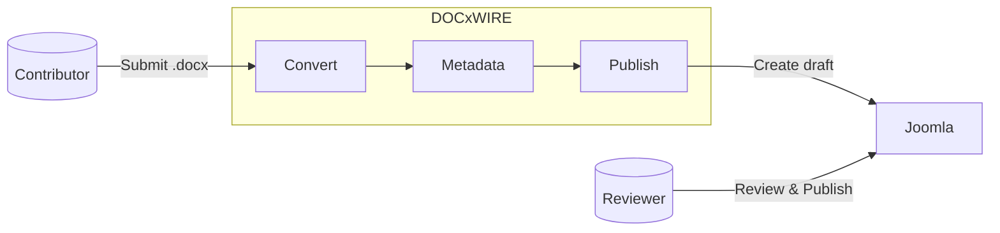

# DOCxWIRE

> Built for the [Heilbronner Rudergesellschaft Schwaben](https://www.ruderschwaben.de/) — but designed
> for reuse. See [`MOTIVATION.md`](MOTIVATION.md).

Converts `.docx` files to clean HTML and publishes them as draft articles to a Joomla 5 website.

