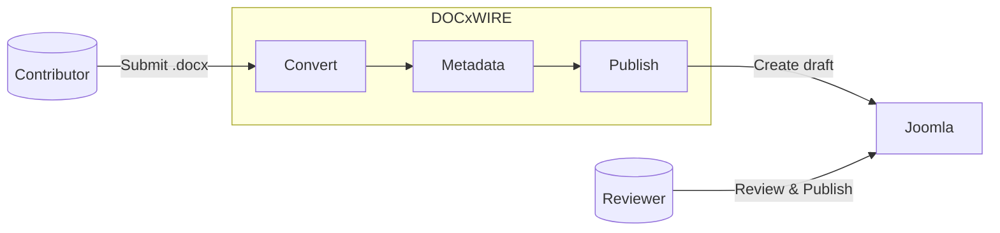

# DOCxWIRE

[](https://conventionalcommits.org)

> Built for the [Heilbronner Rudergesellschaft Schwaben](https://www.ruderschwaben.de/) — but designed
> for reuse. See [`MOTIVATION.md`](MOTIVATION.md).

Converts `.docx` files to clean HTML and publishes them as draft articles to a Joomla 5 website.



## Getting started

This project uses [uv](https://docs.astral.sh/uv/) for Python dependency management and
[Node.js 22](https://nodejs.org/) (with npm) for the JavaScript tooling (OpenSpec CLI, commitlint).

To set up your environment, run:

```bash
make setup   # Setup environment
```

[Make](https://www.gnu.org/software/make/) serves as the task runner for code quality and testing. Available targets:

```bash
make test              # Run test suite with coverage
make check             # Run all checks
make ci                # Full CI (lint + tests)
make fix               # Auto-fix findings
make lint-commit       # Validate a commit message (piped via stdin)
make openspec-validate # Validate OpenSpec artifacts
```

## Spec-driven development

Features are specified with [OpenSpec](https://openspec.dev) before they are built: proposals, designs, and task lists live in [`openspec/`](openspec/), and agent workflow rules in [`AGENTS.md`](AGENTS.md). The OpenSpec workflow skills are committed to the repo (`.agents/skills/openspec-*/`), and the artifacts are validated in CI with the OpenSpec CLI. The CLI version is declared in [`package.json`](package.json) and installed by `make setup`; validate locally with `make openspec-validate`. If you want the bare `openspec` command on your `PATH` (e.g. to (re)generate the workflow skills with `openspec update`), optionally install the pinned version globally with `npm install -g @fission-ai/openspec@<version from package.json>`.

## Conventional Commits

This project adheres to [Conventional Commits](https://www.conventionalcommits.org/). The `Commit Lint` CI workflow validates commit messages with [commitlint](https://commitlint.js.org/) using the `@commitlint/config-conventional` preset (see [`.commitlintrc.json`](.commitlintrc.json)): it checks the commit landing on `main` and, before a merge, the pull request title. Pull requests are squash-merged, with the title serving as the commit message.

## Dependency updates

[Renovate](https://docs.renovatebot.com/) keeps the dependencies current: the `uv` (`pyproject.toml` + `uv.lock`) and `npm` (`package.json` + `package-lock.json`) ecosystems, the GitHub Actions in the CI workflows, and the pinned Python version (`.python-version`). The full policy lives in [`renovate.json`](renovate.json):

- **Automerged** (gated on the CI status checks required on `main`): `patch` updates, and `minor`/`patch` updates of dev-only dependencies — in both cases only from a `1.0`+ current version.
- **Stays manual** (opens a PR for a human): `major` updates (one PR per major, sequenced), all updates of `0.x` dependencies, and `minor` updates of runtime dependencies.
- **7-day cooldown**: the bot ignores versions released less than 7 days ago (supply-chain cooldown); security updates are not delayed.
- **Weekly lockfile maintenance** refreshes transitive dependencies in `uv.lock` and `package-lock.json` and may automerge.

To request an update outside the normal schedule, or to override the policy for a single dependency, use the Renovate dashboard (re-run the branch) — or open a PR bumping the manifest yourself.
