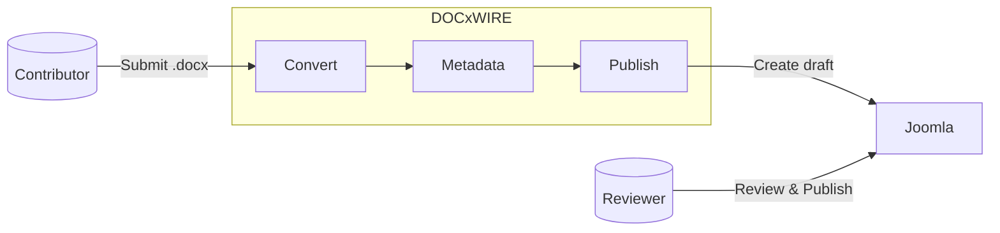

# DOCxWIRE

> Built for the [Heilbronner Rudergesellschaft Schwaben](https://www.ruderschwaben.de/) — but designed
> for reuse. See [`MOTIVATION.md`](MOTIVATION.md).

Converts `.docx` files to clean HTML and publishes them as draft articles to a Joomla 5 website.



## Getting started

This project uses [uv](https://docs.astral.sh/uv/) for dependency management.

To set up your environment, run:

```bash
make setup   # Setup environment
```

[Make](https://www.gnu.org/software/make/) serves as the task runner for code quality checks and fixes. Available targets:

```bash
make check   # Run all checks
make fix     # Auto-fix findings
```
